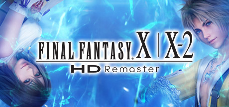

**Final Fantasy X/X-2 HD Remaster by Square Enix (2014) is the definitive version of FFX and its sequel.**

---

## 📖 About

Final Fantasy X/X-2 HD Remaster by Square Enix (2014) is the definitive version of FFX and its sequel. FFX's Sphere Grid character customization and CTB combat are among the series' best. Completing the Monster Arena and defeating the Dark Aeons and Penance represent some of JRPGs' hardest content.

## ⚠️ Problems Without Trainer

| Problem | Status |
|---------|--------|
| Dark Aeons one-shot entire parties without specific stat walls from Monster Arena | ✅ Solved |
| Sphere Grid completion requires farming specific monsters for rare spheres | ✅ Solved |
| Penance has 120,000 HP requiring Overdrive stacking strategies across hours | ✅ Solved |
| Blitzball mini-game required for Wakka Overdrives and weapon abilities | ✅ Solved |
| AP farming for Ultimate Weapons requires specific Double AP equipment setup | ✅ Solved |

## ✅ Solution

The **Final Fantasy X/X-2 HD Remaster Trainer** solves all these issues, giving you complete control so you can focus on enjoying the game.

## 🎯 Features

- Unlimited Resources / Currency
- God Mode / Invincibility
- Instant Skill & Ability Cooldown
- One-Hit Kill
- Freeze Timers
- Unlock All Items & Achievements
- Custom Speed Multiplier
- Infinite Stamina / Energy

## 🚀 Quick Start

1. **Disable Windows Defender** temporarily (trainer may trigger false positive)
2. Get the trainer from the button above
3. Launch Final Fantasy X/X-2 HD Remaster
4. Run the trainer as Administrator
5. Use the hotkeys to activate cheats in-game

## 💎 Free vs Pro

| Feature | Free | Pro |
|---------|------|-----|
| God Mode | ✅ | ✅ |
| Unlimited Resources | ✅ | ✅ |
| Advanced Cheats | ❌ | ✅ |
| Auto-Updates | ❌ | ✅ |
| Priority Support | ❌ | ✅ |

## 💻 Requirements

- Windows 10 / 11 (64-bit)
- Final Fantasy X/X-2 HD Remaster (any version)
- .NET Framework 4.8+
- DirectX 11+

## 🍎 macOS

## ⚖️ Legal

Educational and single-player use only.

---

